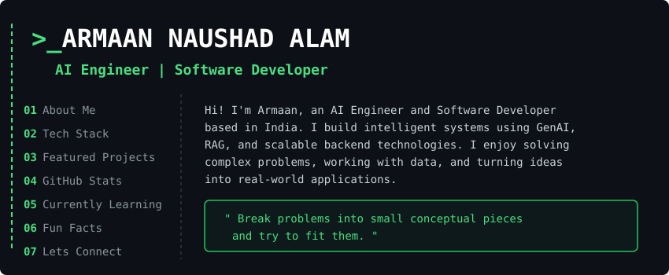

  

  <!-- Dynamic Typing Header in GitHub Contribution Green (#39d353) -->
  

  

    <code>AI & NLP Systems</code> • <code>Production RAG</code> • <code>Distributed Backends</code> • <code>Database Optimization</code>
  

  <!-- Connect Buttons in GitHub Dark & Contribution Green -->
  

    
    
    
    
    
  

---

### ❯ Featured Projects
<!-- START_SECTION:featured_projects -->
<table width="100%">
  <tr>
    <td width="50%" valign="top">
      
    </td>
    <td width="50%" valign="top">
      
    </td>
  </tr>
  <tr>
    <td width="50%" valign="top">
      
    </td>
    <td width="50%" valign="top">
      
    </td>
  </tr>
</table>
<!-- END_SECTION:featured_projects -->

---

### ❯ Tech Stack

<b>Languages:</b>

  

<b>AI, Frameworks & Libraries:</b>

  
  
  
  
  

<b>Databases & Caching:</b>

  

<b>Tools & Platforms:</b>

  

---

### ❯ Stats & Contribution Rhythm

<table width="100%">
  <tr>
    <td width="50%" valign="top">
      <!-- GitHub Stats (GitHub Dark Theme + Contribution Green) -->
      
    </td>
    <td width="50%" valign="top">
      <!-- GitHub Top Languages -->
      
    </td>
  </tr>
  <tr>
    <td width="50%" valign="top">
      <!-- LeetCode Activity Card -->
      
    </td>
    <td width="50%" valign="top">
      <!-- GFG Stats Card -->
      
    </td>
  </tr>
</table>

---

  

